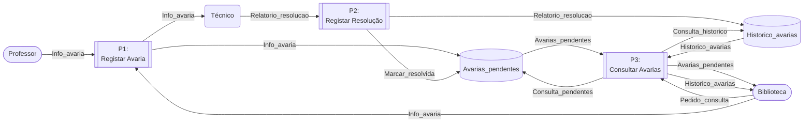
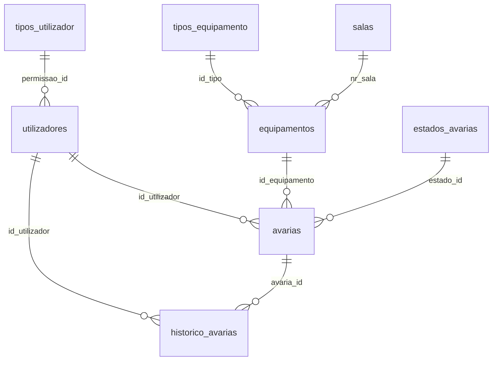

# Projeto Avaria — Gestão de Avarias

Aplicação web para reportar e acompanhar avarias de equipamentos nas salas do Agrupamento de Escolas de Lousada. Os professores e a biblioteca registam a avaria, o técnico trata dela e regista a resolução, e fica tudo guardado num histórico.

## Índice

1. [Problema](#problema)
2. [Solução](#solução)
3. [Perfis de utilizador](#perfis-de-utilizador)
4. [Fluxo de dados](#fluxo-de-dados)
5. [Tecnologias](#tecnologias)
6. [Estrutura do projeto](#estrutura-do-projeto)
7. [Base de dados](#base-de-dados)
8. [Como correr](#como-correr)
9. [Estado do projeto](#estado-do-projeto)
10. [Documentação](#documentação)

## Problema

Quando um equipamento avaria numa sala, o problema é normalmente comunicado na biblioteca e registado numa folha de cálculo em Excel. A informação que chega ao técnico, e o que ele fez para resolver, não fica documentada. O processo é difícil de controlar e torna-se mais complicado à medida que a escola recebe mais equipamentos.

## Solução

Um site próprio, com login, onde:

- quem encontra a avaria escolhe a sala e o equipamento, descreve o problema e pode juntar uma fotografia;
- o técnico vê as avarias por resolver, muda o estado e escreve o relatório da resolução;
- a biblioteca consulta as avarias pendentes e o histórico;
- cada alteração fica registada.

## Perfis de utilizador

| Ação | Professor | Biblioteca | Técnico |
|---|---|---|---|
| Registar avaria | sim | sim | não |
| Ver avarias | só as suas | todas (só leitura) | todas |
| Mudar estado e registar resolução | não | não | sim |
| Gerir contas, salas, equipamentos e tipos (Backoffice) | não | não | sim |

As permissões são sempre verificadas no servidor. Detalhe em [docs/permissoes-e-seguranca.md](docs/permissoes-e-seguranca.md).

## Fluxo de dados



## Tecnologias

| Parte | Tecnologia |
|---|---|
| Frontend | HTML, CSS e JavaScript (módulos ES, sem frameworks nem passo de build) |
| Backend | Web API em C# com ASP.NET Core 8 e Entity Framework Core |
| Base de dados | PostgreSQL no Supabase |
| Testes | xUnit com `WebApplicationFactory` |

A API serve também o frontend, por isso a aplicação inteira abre num só endereço.

## Estrutura do projeto

```
Avarias.sln                    solução .NET (API + testes)
src/Avarias.Api/               API ASP.NET Core
├─ Controllers/                Auth, Catalogos, Reportes, Admin
├─ Models/                     entidades da base de dados
├─ Dtos/                       pedidos e respostas da API
├─ Data/                       AppDbContext e dados iniciais
├─ Services/                   tokens e envio de email
├─ Extensions/                 configuração do arranque
└─ wwwroot/                    frontend
   ├─ *.html                   uma página por ecrã
   ├─ css/styles.css           estilos e cores do design system
   └─ js/core/, js/pages/      código partilhado e um ficheiro por página
tests/Avarias.Api.Tests/       testes das regras de acesso
database/                      esquema do Supabase e scripts SQL
scripts/                       atalhos PowerShell
docs/                          documentação técnica
```

Onde pôr código novo: [docs/arquitetura.md](docs/arquitetura.md).

## Base de dados

PostgreSQL no Supabase. Estrutura atual (exportada em [database/esquema-supabase.csv](database/esquema-supabase.csv)):



| Tabela | Para quê | Campos principais |
|---|---|---|
| `utilizadores` | contas (o `id` liga à autenticação do Supabase) | `nome_utilizador`, `permissao_id` |
| `tipos_utilizador` | perfis | `tipo_utilizador` (Professor, Biblioteca, Técnico) |
| `salas` | salas e outros espaços | `nr_sala`, `tipo_sala` |
| `tipos_equipamento` | categorias de equipamento | `desc_tipo` |
| `equipamentos` | equipamentos de cada sala | `nr_serie`, `nr_sala`, `id_tipo`, `desc_equipamento` |
| `estados_avarias` | estados possíveis de uma avaria | `desc_estado` |
| `avarias` | avarias reportadas | `desc_geral`, `id_utilizador`, `id_equipamento`, `estado_id`, `data_avaria`, `foto_avaria`, `data_resolucao`, `desc_resolucao`, `foto_resolucao` |
| `historico_avarias` | cópia de cada registo, com os dados da altura (sala, equipamento, estado) | `avaria_id`, `desc_detalhes`, `desc_estado`, `data_registo` e cópias dos campos da avaria |

> **Atenção:** o código da API ainda usa o modelo anterior (tabelas `reportes`, `locais`, `tipos_avaria`, login próprio com email e palavra-passe). Tem de ser adaptado a esta estrutura antes de ligar a API a esta base de dados. Ver [Estado do projeto](#estado-do-projeto).

## Como correr

**Requisitos:** [.NET 8 SDK](https://dotnet.microsoft.com/download/dotnet/8.0) e um projeto Supabase. Os comandos correm a partir da raiz do projeto, em PowerShell.

**1. Ligação à base de dados.** No Supabase, em **Connect → Direct → Session pooler**, copiar a ligação em formato .NET. Depois:

```powershell
.\scripts\configurar-segredos.ps1
```

O script pede a ligação e gera a chave JWT. Os dois ficam guardados em `dotnet user-secrets`, fora do repositório. A palavra-passe da base de dados nunca vai para o `appsettings.json`.

**2. Arrancar** (API e frontend em http://localhost:5080):

```powershell
.\scripts\correr-api.ps1
```

**3. Testes** (não precisam de base de dados):

```powershell
.\scripts\testar.ps1
```

**Modo demo.** Só o frontend, com dados de exemplo simulados no browser, sem API nem base de dados. Depois de correr o comando, abrir http://localhost:5173/login.html?demo=1:

```powershell
.\scripts\correr-demo.ps1
```

| Perfil (contas de teste) | Email | Palavra-passe |
|---|---|---|
| Professor | professor@escola.test | Professor123! |
| Biblioteca | biblioteca@escola.test | Biblioteca123! |
| Técnico | tecnico@escola.test | Tecnico123! |

Estas contas existem só em desenvolvimento e no modo demo.

## Estado do projeto

Feito:

- [x] Frontend completo: login, recuperação de palavra-passe, painel com filtros, registar avaria com fotografia, detalhe com histórico, backoffice
- [x] API com regras de acesso por perfil e testes
- [x] Design system aplicado a toda a interface
- [x] Modo demo sem base de dados
- [x] Base de dados criada no Supabase

Por fazer:

- [ ] Adaptar a API e o frontend à nova estrutura da base de dados
- [ ] Decidir a autenticação: Supabase Auth (como sugere `utilizadores.id`) ou login próprio da API
- [ ] Testar ponta a ponta contra o Supabase
- [ ] Configurar o envio de emails (SMTP)
- [ ] Testar num telemóvel real
- [ ] Publicar ([docs/deploy.md](docs/deploy.md))

## Documentação

| Documento | Conteúdo |
|---|---|
| [docs/arquitetura.md](docs/arquitetura.md) | Estrutura das pastas e onde pôr código novo |
| [docs/api.md](docs/api.md) | Endpoints da API |
| [docs/base-de-dados.md](docs/base-de-dados.md) | Modelo de dados da API |
| [docs/permissoes-e-seguranca.md](docs/permissoes-e-seguranca.md) | Perfis e proteções |
| [docs/design-system.md](docs/design-system.md) | Cores, letra e componentes |
| [docs/deploy.md](docs/deploy.md) | Pôr em produção |
