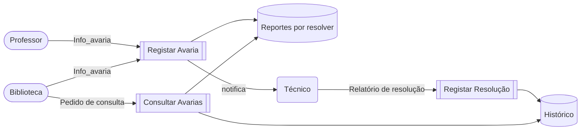

# Arquitetura

Uma só aplicação ASP.NET Core 8 que serve a **API** (`/api/...`) e o **frontend** (ficheiros estáticos em `wwwroot`) na mesma origem. Não há passo de build no frontend nem frameworks JavaScript.

```
Browser ──► ASP.NET Core (Kestrel, porta 5080)
              ├─ /*.html, /css, /js, /img   → wwwroot (estático)
              └─ /api/*                      → Controllers ──► EF Core ──► PostgreSQL (Supabase)
                                                         └──► pasta uploads/ (fotos)
```

## Estrutura de pastas

```
Projeto PASP/
├─ Avarias.sln                 solução (abrir no Visual Studio / Rider / VS Code)
├─ Directory.Build.props       definições .NET comuns (net8.0, nullable…)
├─ global.json                 versão do SDK .NET
├─ .editorconfig               estilo de código
├─ README.md                   arranque rápido
├─ HANDOFF.md                  estado do projeto e decisões
│
├─ src/Avarias.Api/            API + frontend
│  ├─ Program.cs               arranque (curto; a configuração está em Extensions/)
│  ├─ Extensions/              ServiceCollectionExtensions (BD, JWT, rate limit, erros)
│  │                           WebApplicationExtensions (pipeline, criar BD + seed)
│  ├─ Controllers/             Auth, Catalogos, Reportes, Admin
│  ├─ Models/                  uma entidade por ficheiro
│  │  └─ Enums/                Perfil, Estado, Urgencia, Prioridade
│  ├─ Dtos/                    AuthDtos, CatalogoDtos, ReporteDtos, AdminDtos
│  ├─ Data/                    AppDbContext (única definição do esquema), DbSeeder
│  ├─ Services/
│  │  ├─ Auth/                 TokenService (JWT e tokens de recuperação)
│  │  └─ Email/                IEmailSender, ConsoleEmailSender, SmtpEmailSender
│  ├─ Properties/              launchSettings.json (dotnet run → Development)
│  ├─ appsettings*.json        configuração (sem segredos: esses vão em user-secrets)
│  └─ wwwroot/                 frontend
│     ├─ *.html                uma página por ecrã
│     ├─ css/styles.css        todo o CSS, tokens do design system no topo
│     ├─ img/                  logótipo da escola
│     └─ js/
│        ├─ core/              api.js (cliente da API), common.js (el(), autenticar(), cabeçalho),
│        │                     demo.js (API simulada para o modo demo)
│        └─ pages/             um módulo por página HTML (login.js, painel.js, …)
│
├─ tests/Avarias.Api.Tests/    xUnit + WebApplicationFactory + EF InMemory
├─ database/
│  └─ scripts/                 SQL para correr à mão no Supabase
├─ scripts/                    atalhos PowerShell (correr API, demo, testes)
└─ docs/                       esta documentação
```

## Fluxo de dados (do enunciado)



Na implementação, "pendentes" e "histórico" são a mesma tabela `reportes` filtrada pelo estado, e cada alteração fica em `historico_reportes`.

## Onde pôr código novo

| Quero… | Onde |
|---|---|
| Uma entidade / tabela nova | `Models/NovaEntidade.cs` + `DbSet` e regras em `Data/AppDbContext.cs` (ver [base-de-dados.md](base-de-dados.md)) |
| Um endpoint novo | Controller existente ou novo em `Controllers/`; pedidos e respostas em `Dtos/` |
| Lógica reutilizável (email, ficheiros, relatórios) | `Services/<Área>/` e registar em `Extensions/ServiceCollectionExtensions.cs` |
| Uma página nova | `wwwroot/nova.html` + `wwwroot/js/pages/nova.js`; usar `el()` e `autenticar()` de `js/core/common.js` |
| Um endpoint novo no modo demo | `wwwroot/js/core/demo.js` |
| Um teste | `tests/Avarias.Api.Tests/` (usa `ApiFactory`, sem base de dados real) |

## Convenções

- Português de Portugal em textos, nomes de classes e comentários.
- Erros da API sempre como `{ "message": "..." }`.
- Frontend: DOM criado com `el()` (só `textContent`, nunca `innerHTML`).
- Segredos só em `dotnet user-secrets` (desenvolvimento) ou variáveis de ambiente (produção).
