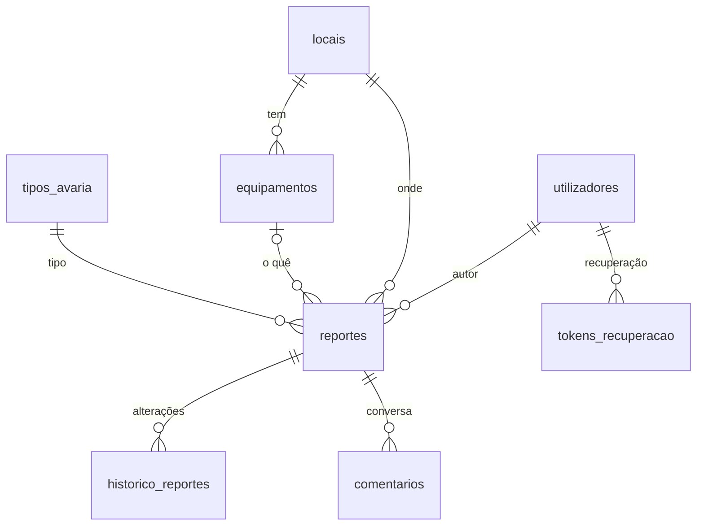

# Base de dados

PostgreSQL (Supabase). O modelo EF Core em `src/Avarias.Api/Data/AppDbContext.cs` é a **única definição do esquema**; os nomes ficam em `snake_case`. No arranque, `EnsureCreated` cria as tabelas se não existirem e o `DbSeeder` insere os dados iniciais.

## Tabelas

| Tabela | Campos principais | Regras |
|---|---|---|
| `utilizadores` | nome, email, password_hash, perfil, ativo | email único e em minúsculas; perfil em `Professor`, `Biblioteca`, `Tecnico` |
| `locais` | nome, e_biblioteca | nome único |
| `equipamentos` | nome, local_id | |
| `tipos_avaria` | nome | nome único |
| `reportes` | titulo, descricao, local/equipamento/tipo, urgencia, prioridade, estado, foto_ficheiro, autor_id, resolucao, datas | FKs com `Restrict` (não se apaga um local com reportes) |
| `historico_reportes` | campo, valor_anterior, valor_novo, utilizador_id, data | apagado em cascata com o reporte |
| `comentarios` | texto, autor_id, criado_em | apagado em cascata com o reporte |
| `tokens_recuperacao` | token_hash (SHA-256), expira_em, usado | uso único, 1 h |

Enums guardados como texto: `Estado` (Pendente, EmAnalise, EmResolucao, Resolvido), `Urgencia` (Baixa, Media, Alta), `Prioridade` (Baixa, Media, Alta, Critica).

As fotos **não** ficam na base de dados: estão na pasta `uploads/` (configurável em `Uploads:Pasta`), com nome gerado pelo servidor.

## Mudar o esquema

`EnsureCreated` não altera tabelas que já existam. Enquanto não houver migrações:

1. Mudar o modelo (`Models/`) e `AppDbContext`.
2. Em desenvolvimento: apagar as tabelas e arrancar de novo.
3. Em produção: escrever o SQL (`alter table …`) em `database/scripts/` e corrê-lo no SQL Editor do Supabase.

Quando o projeto estiver em produção a sério, passar para migrações EF (`dotnet ef migrations add Inicial`) e trocar `EnsureCreated` por `Migrate()` em `Extensions/WebApplicationExtensions.cs`.

## Scripts

| Ficheiro | Para quê |
|---|---|
| `database/scripts/criar-utilizador.sql` | criar a 1.ª conta de técnico em produção (bcrypt via pgcrypto) |
