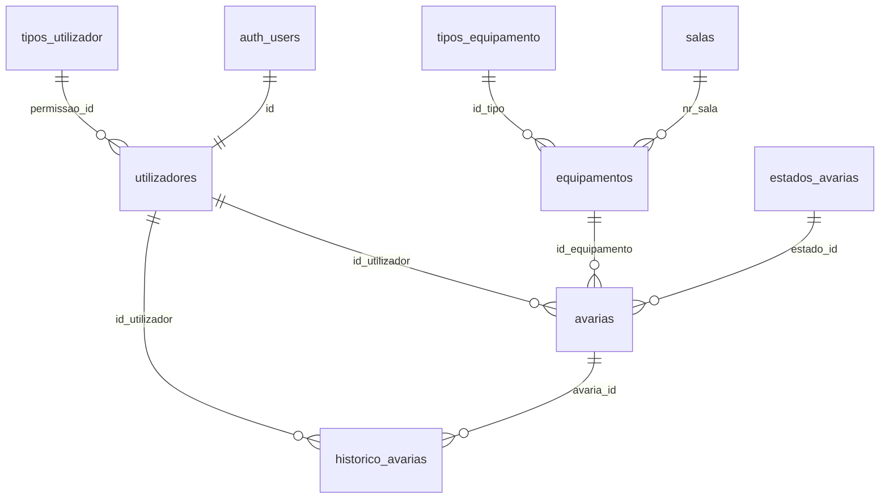

# Base de dados

PostgreSQL no Supabase. As tabelas foram criadas no Supabase e são a **fonte da verdade**: a API não cria nem altera o esquema. A estrutura atual está exportada em [database/esquema-supabase.csv](../database/esquema-supabase.csv) e o mapeamento está em `src/Avarias.Api/Data/AppDbContext.cs`.

## Tabelas

| Tabela | Para quê | Como a aplicação a usa |
|---|---|---|
| `auth.users` | contas do Supabase Auth (email, palavra-passe, bloqueio) | só leitura (email e `banned_until`); alterações pela API de administração do Supabase |
| `utilizadores` | nome e perfil de cada conta (`id` = `auth.users.id`) | sem linha aqui a pessoa não entra |
| `tipos_utilizador` | perfis | o texto tem de ser Professor, Biblioteca ou Técnico (com ou sem acento) |
| `salas` | salas (`nr_sala` é a chave) | `tipo_sala` = "Biblioteca" marca os espaços da biblioteca |
| `tipos_equipamento` | categorias de equipamento | filtro do painel |
| `equipamentos` | equipamentos de cada sala | `nr_serie` único |
| `estados_avarias` | estados | "Pendente" é o inicial; "Resolvido" exige resolução. Comparados sem acentos nem maiúsculas |
| `avarias` | avarias registadas | a sala vem do equipamento |
| `historico_avarias` | cópia da avaria em cada momento | uma linha na criação e em cada alteração; `desc_detalhes` diz o que mudou |

As fotografias não ficam na base de dados: estão na pasta `uploads/` do servidor e as colunas `foto_avaria` / `foto_resolucao` guardam só o nome do ficheiro.

## O que a API garante no arranque

`Data/DbSeeder.cs` (desligável com `BaseDeDados:GarantirDadosBase = false`):

- acrescenta a `tipos_utilizador` os perfis que faltarem (Professor, Biblioteca, Técnico);
- se `estados_avarias` estiver vazia, cria Pendente, Em análise, Em resolução, Resolvido.

Nada mais é escrito sem uma ação de um utilizador.

## Mudar o esquema

1. Mudar a tabela no Supabase (Table Editor ou SQL Editor) e guardar o SQL em `database/scripts/` com a data no nome.
2. Atualizar a classe em `Models/` e o mapeamento em `Data/AppDbContext.cs`.
3. Exportar de novo `database/esquema-supabase.csv` com a consulta do [database/README.md](../database/README.md).

## Segurança das tabelas (RLS)

A API liga-se com o utilizador `postgres`, que ignora as políticas RLS. O browser nunca fala diretamente com a base de dados. Se isso mudar, é preciso ativar RLS e criar políticas em todas as tabelas.
